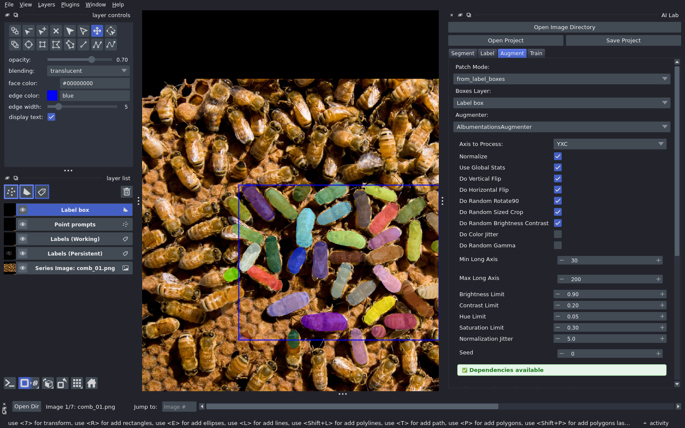
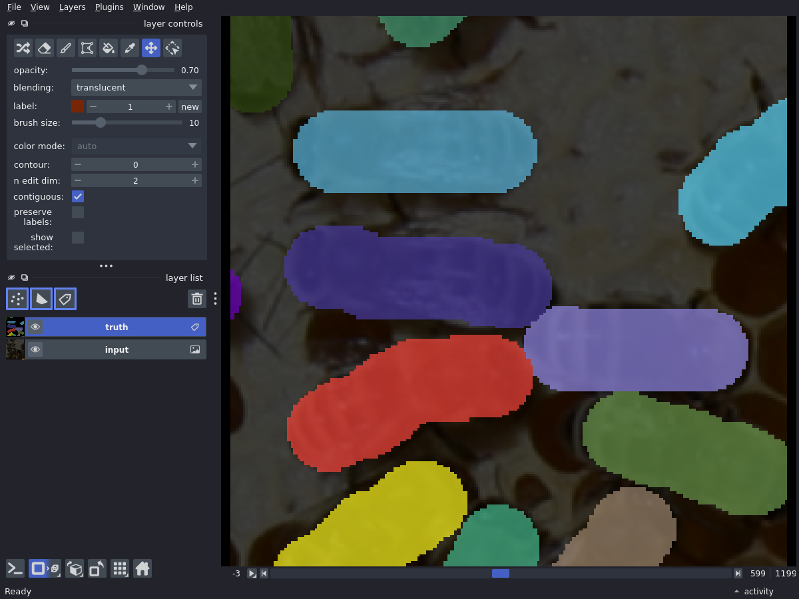
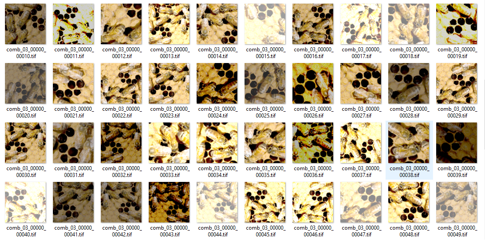

# Augment

Augmentation turns a few labelled areas into many training patches.

AI Lab's augmenter does more than the one built into most trainers. It has
over ten options: flips, 90° rotations, crops sized to your objects,
brightness and contrast, colour jitter, gamma and normalization jitter. Turn
each on or off, and tune it, in the Augment tab.

## Why AI Lab augments explicitly

- AI Lab augments before training and saves the patches to disk.
- A handful of label boxes become hundreds of patches.
- You can look at exactly what training will see.

Some trainers also augment during training. That is fine: the patches are
augmented twice. Built-in augmentation varies from trainer to trainer. Some is
simple, some is elaborate and slow, and it is harder to inspect.

## Steps

1. **Save Project** first. Augmentation reads the saved labels.
2. **Augment** tab:
    - **Patch Mode**: `from_label_boxes`.
    - **Augmenter**: `AlbumentationsAugmenter`.
    - Pick the transforms: flips, rotate 90, random sized crop, brightness and contrast.
    - **Patch Size (XY)**: the size training reads. Linked to the Train tab.
    - **Number of Patches**.
3. **Perform Augmentations**.

**Delete Augmentations** clears the old patches before a new run.

## Check the patches

**Show Patches** opens them in a second napari viewer. Drag the slider to step
through them.

Or open the project folder in a file browser, under
`patches/patches_axis_yxc/`: `input0/` holds the images, `ground_truth0/` the
labels.

`comb_03_00000_00010.tif` is image `comb_03`, label box `00000`, patch `00010`.
