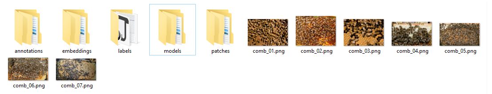

# Get data

*From notebook 12.*

## Get the images

- TODO

## Small data (optional)

- TODO

## Load one back

- TODO

## The project folder

- One folder of images.
- AI Lab adds folders beside them.

