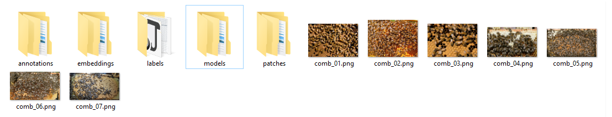

# Get data

## Use your own images

Put the images you want to work on in one folder. That folder is your project.

- Only images in the folder, nothing else.
- Types: `.tif`, `.png`, `.jpg`, `.bmp`, `.czi`.
- Sizes can differ from image to image.
- Include the hard images, not just the easy one.

AI Lab treats the folder as a sequence and steps through it image by image.
The point is to find out whether a model works on all your images, not just
the first one you tried.

## What AI Lab adds

AI Lab never changes your images. It adds folders beside them as you work.
This is a bees project after some labelling and one training run:

- **annotations**: the labels you draw, one file per image.
- **labels**: the parts of your annotations inside a label box. Only these are
  used for training.
- **patches**: training data made from the labels by augmentation.
- **models**: one per training run.
- **embeddings**: SAM's cache. Safe to delete; it is rebuilt when needed.

## Example data

To try AI Lab before using your own images, download the examples from the
[I2K 2026 tutorial](https://github.com/bnorthan/i2k-2026):

- **pollen**: easiest.
- **bees**: medium. Needs some training to find bees and not honeycomb cells.
- **ladybugs**: hard.

[Download the example data (zip)](https://www.dropbox.com/scl/fo/ock3qfwx11mvbfuih0hsc/AGk9LFOqnfm3HG_zw22vIv8?rlkey=aaoac1euyg89hpadnms96e2c9&st=4ck6sxe3&dl=1).
Each set is its own folder, ready to open as a project.
