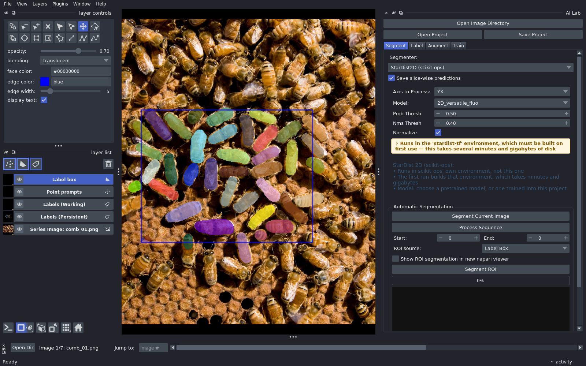

# napari-ai-lab

!!! warning "Under construction"
    Very new. Expect changes.

## Napari ai-lab main functionality

- Loads folders of images as a sequence.
- Can segment with popular models such as Cellpose and micro-sam.
- Fine tune labels with manually or with SAM.
- Mark up finished areas that are ready for training.
- Augment to add training data.
- Train models.

