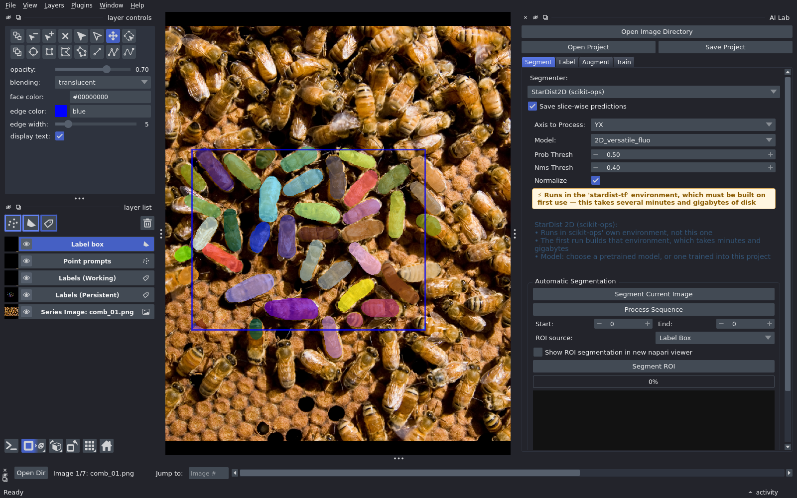

# napari-ai-lab

!!! warning "Under construction"
    Very new. Expect changes.

## What AI Lab does

- Load a folder of images as a sequence.
- Segment with popular models such as Cellpose and micro-sam.
- Not good enough? Draw labels, or click with SAM.
- Label boxes mark finished areas.
- Augment to add training data.
- Train a model.

