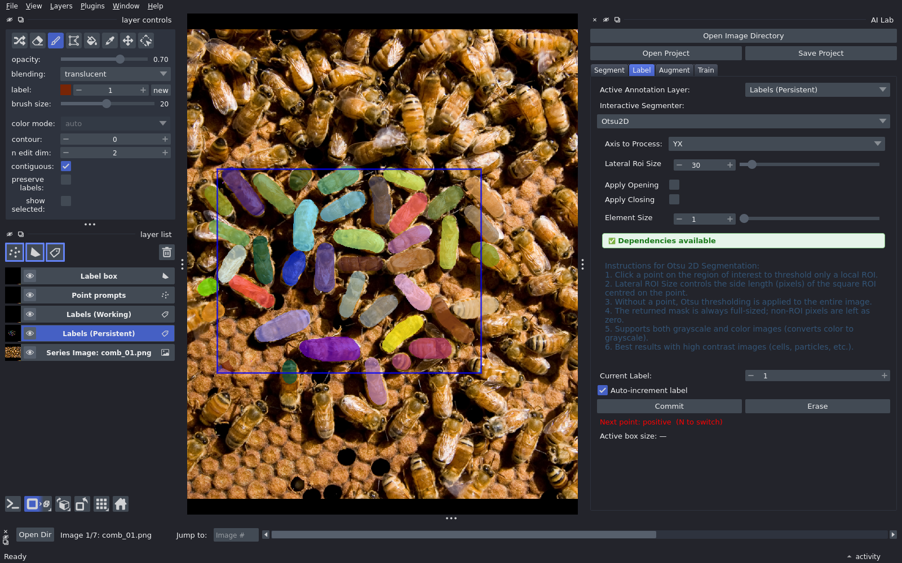
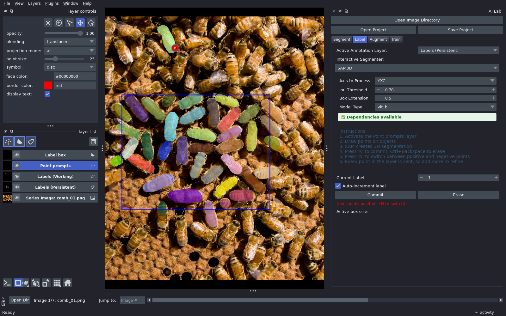

# Label

## The layers you use

| layer | what it is for |
|---|---|
| **Labels (Persistent)** | your labels. Draw here. Saved with the project |
| **Label box** | marks areas you are happy with. Only labels inside a box are used for training |
| **Point prompts** | clicks for interactive segmentation (SAM) |
| **Labels (Working)** | interactive results, until you commit them to Labels (Persistent) |

## Not everything you draw is used for training

- Draw on Labels (Persistent) as much as you like. It is all saved, finished or not.
- When every object in an area is labelled, put a label box around it.
- Only boxed areas train. Unlabelled objects inside a box count as background.

## Draw by hand

- Select **Labels (Persistent)** in the layer list.
- Paint with napari's brush and fill tools.

## Draw with SAM

Needs the **microsam** install.

- **Label** tab: choose **SAM3D** as the interactive segmenter.
- Select **Point prompts** and click an object. The result appears on
  **Labels (Working)**.
- Press **k** (or **Commit**) to keep it on Labels (Persistent).
- Press **n** to switch the next point between positive and negative.
- The first click on an image computes SAM's embedding, which takes 20 to 60
  seconds. After that, clicks are fast.

## Mark finished areas

- Select **Label box** and draw a rectangle around an area you have finished.
- **Save Project**. AI Lab also saves when you switch images or close.
