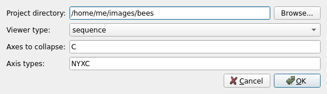
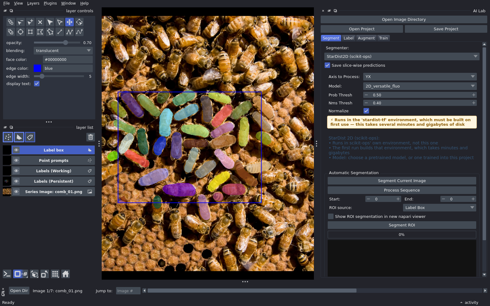

# Launch

The goal: AI Lab open on your own project folder.

## Choose the project

- A folder of your images. See [Get data](get-data.md).
- New to AI Lab? Start with an example set: bees, pollen or ladybugs.

## The settings

The same settings apply whichever way you launch.

| setting | usual value | why |
|---|---|---|
| viewer type | `sequence` | images can differ in size. Use `stacked` only if they are all the same size |
| axes to collapse | `C` | colour is not an axis you label along, so labels are 2D per image. Blank for greyscale |
| axis types | `NYXC` | N images, each Y by X, with colour. Blank to detect automatically |
| profile | `2d-instance` | which segmenters and tools appear. `2d-detect` for boxes, `all` for everything |

## 1. From the napari menu

- **Plugins → Napari AI Lab → 2D Instance AI Lab**. The entry picks the
  profile: **2D Detect AI Lab** for boxes, **ND AI Lab** for everything.
- Click **Open Project**.
- **Browse...** to your folder, fill in the settings, click **OK**.



> **SCREENSHOT TODO:** Plugins menu

## 2. From Python or a notebook

```python
import napari
from napari_ai_lab.apps.nd_ai_lab_launcher import launch_nd_ai_lab

project = "/path/to/my/images"

viewer = napari.Viewer()
launch_nd_ai_lab(
    viewer,
    project,
    viewer_type="sequence",
    axes_to_collapse="C",
    axis_types="NYXC",
    profile="2d-instance",
)
napari.run()  # in a script; leave out in a notebook
```

## 3. With a pixi task

Handy for a project you open often.

- Save the Python above as `launch_cells.py` next to your `pixi.toml`.
- Add a task to `pixi.toml`:

```toml
[tasks]
cells = "python launch_cells.py"
```

- Then, from that folder: `pixi run cells`.

## Using it

- **Sequence Viewer**, at the bottom: moves between images.
- **AI Lab**, on the right: Segment, Label, Augment and Train tabs.


