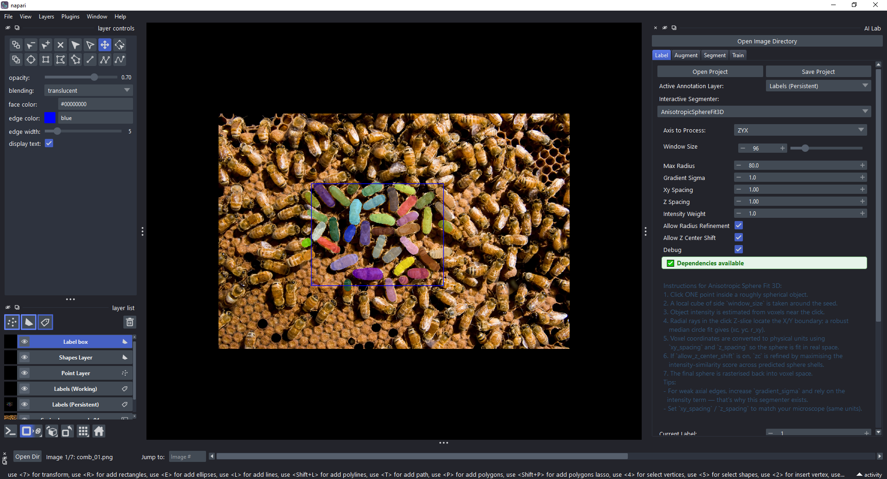

# Launch

*From notebooks 14, 30, 58.*

## What AI Lab does

- TODO

## Choose the project

- TODO

## Launch

- From napari menu.
- From Python.
- From command line.

## Why those arguments

- TODO

## Using it

- Sequence Viewer moves between images.
- AI Lab dock on right.

