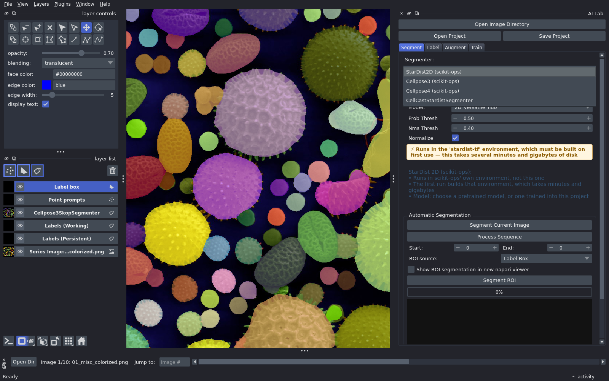

# Segment

Try a ready-made model first. If it works on all your images, you are done.

## Steps

1. Open your project. See [Launch](launch.md).
2. **Segment** tab: choose a segmenter (StarDist, Cellpose 3, Cellpose 4, ...).
    - Check the banner under the settings. Green: ready to run. Red: not installed.
      Yellow: scikit-ops will install it in its own environment on first use.
3. Choose a model and adjust the settings.
4. **Segment Current Image**. The result is a new layer named after the segmenter.
5. **Process Sequence** runs every image, or set **Start** and **End** for a range.
6. Step through the images with the Sequence Viewer and check them.

## Good to know

- A yellow segmenter builds its environment on the first run. This may take a
  few minutes to install and may require a few gigabytes of free disk space.
  Green ones run in AI Lab's environment, or one already built.
- Results are saved in the project's `predictions/` folder, one folder per segmenter.
- **Segment ROI** runs only inside your label boxes. Quick for trying settings.
- The model list includes models you trained in this project.

## Settings to adjust

- **Cellpose diameter**: the typical object size in pixels. If it's too small,
  larger objects can be split or missed. If it's too large, small objects can be
  missed or merged. It's very important in Cellpose 3, less so in Cellpose 4,
  but it still needs tweaking in some cases.
- **Cellpose flow_threshold**: a quality check on the finished masks. Cellpose
  compares the flows of each mask with the flows the network predicted, and
  removes masks where they differ by more than the threshold. Raise it to keep
  more objects, including irregular ones. Lower it to keep only the clean ones.
- **Cellpose cellprob_threshold**: lower it to keep more (and larger) objects,
  raise it to keep fewer.
- **StarDist prob_thresh**: lower it to find more objects.
- **StarDist nms_thresh**: raise it to allow objects to overlap more.

## Not good enough?

- Copy the predictions into your labels and fix the mistakes.
- Then [Label](label.md), [Augment](augment.md) and [Train](train.md).
