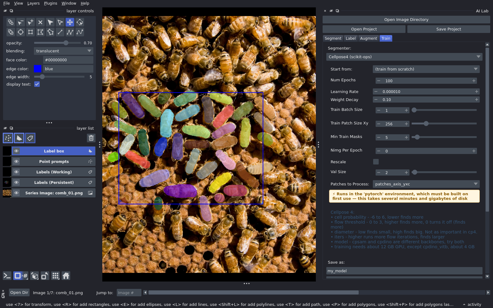

# Train

Train when a ready-made model is not good enough on your images.

## Before you train

Label, put label boxes around finished areas, save, then augment. Training
reads the patches.

## Steps

1. **Train** tab: choose a segmenter (StarDist, Cellpose 3, Cellpose 4).
2. **Start from**: a pretrained model, a model you trained earlier in this
   project, or from scratch. Fine-tuning a pretrained model needs far fewer
   labels.
3. **Num Epochs** and **Learning Rate**: start with the defaults.
4. **Patches to Process**: the patches you made on the Augment tab.
5. **Save as**: a name for the new model.
6. **Train Model**. Progress shows below the button.
7. **Show Training History**: the loss for each epoch.

As on the Segment tab, a yellow segmenter builds its environment on the first
run.

## After training

- The model is saved in the project's `models/` folder.
- It appears in the model list on the Segment tab.
- Segment every image and check them. Fix the mistakes, add labels, and train
  again, starting from your last model.

## Tips

- Cellpose 4 training needs about 12 GB of GPU memory. `cpdino_vitb` needs
  about 4 GB.
- A network only sees a limited area around each pixel. If objects are much
  bigger than that, it cannot see their edges. Larger patches and bigger
  networks help.
