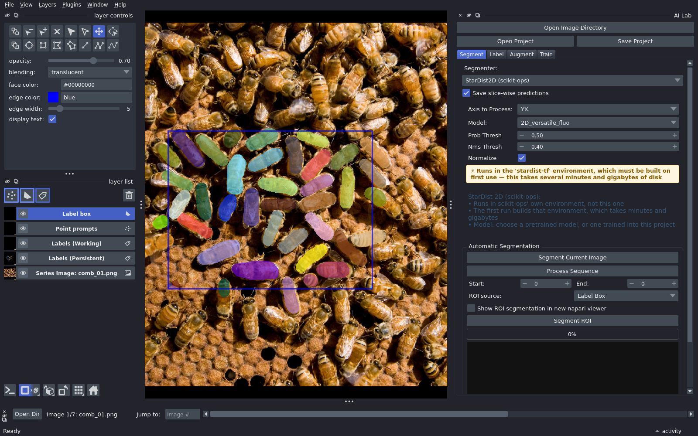

# napari-ai-lab

!!! warning "Under construction"
    Very new. Expect changes.

## Napari ai-lab main functionality

- Loads folders of images as a sequence.
- Can segment with popular models such as Cellpose and micro-sam.
- Fine tune labels with manually or with SAM.
- Mark up finished areas that are ready for training.
- Augment to add training data.
- Train models.

## Labs

- [2D Instance](instance/10-segment.md): one mask per object. Cellpose, StarDist, SAM.
- [2D Detect](detect/index.md): boxes with a class. YOLO. Docs coming soon.

